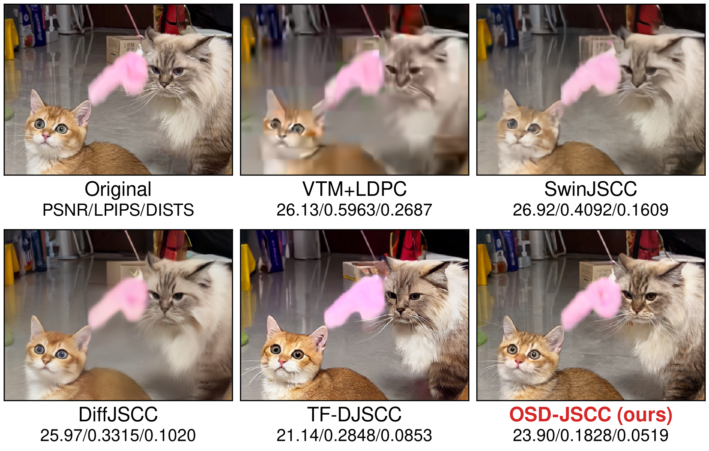
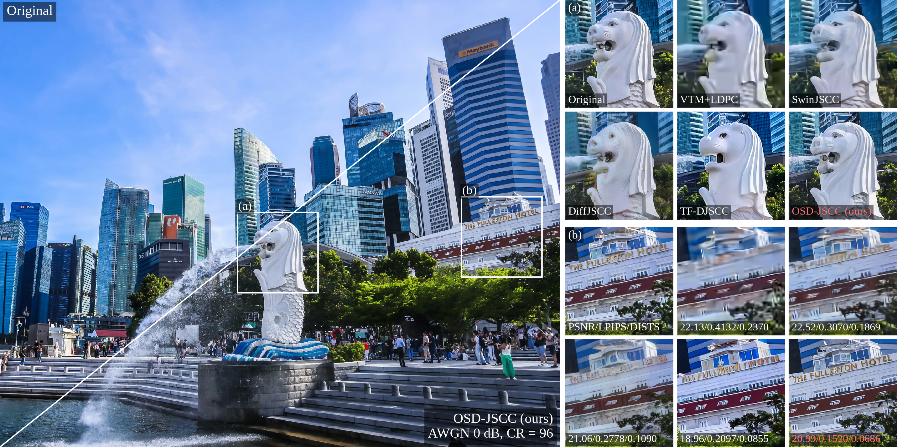
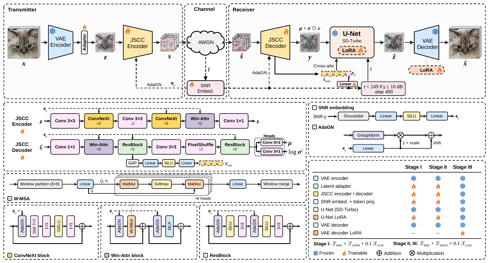
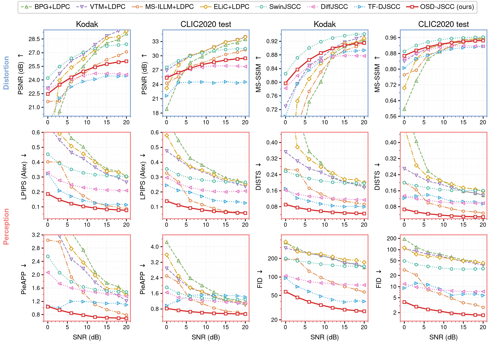
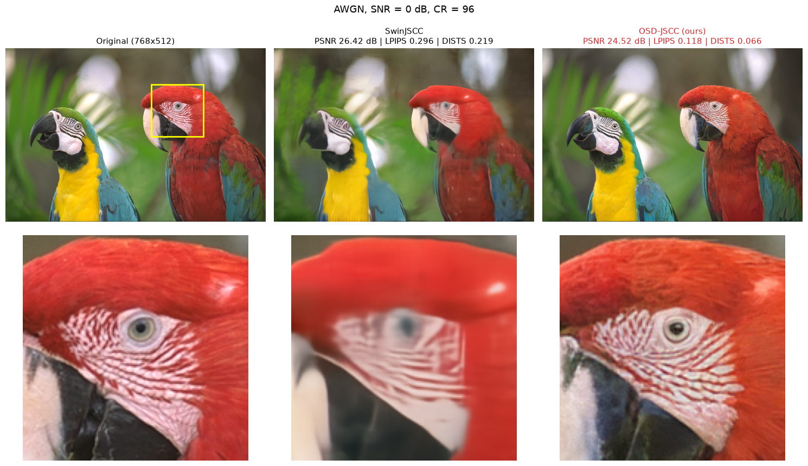

<p align="center">
  
</p>

<h1 align="center">OSD-JSCC: Neural Joint Source–Channel Coding<br>with One-Step Diffusion</h1>

<p align="center">
  <a href="https://tangshunpu.github.io/OSD_JSCC_Project/"></a>
  <a href="https://colab.research.google.com/github/tangshunpu/OSD-JSCC/blob/main/demo.ipynb"></a>
  <a href="https://huggingface.co/tangshunpu/OSD-JSCC"></a>
</p>

<p align="center">
  <a href="https://tangshunpu.github.io/OSD_JSCC_Project/">🌐 Project page</a> &nbsp;·&nbsp;
  📄 Paper (coming soon) &nbsp;·&nbsp;
  <a href="#-visual-comparison">🖼️ Visual comparison</a> &nbsp;·&nbsp;
  <a href="#-inference">🚀 Inference</a> &nbsp;·&nbsp;
  <a href="#-pretrained-weights">📦 Weights</a>
</p>

OSD-JSCC sends an image over a noisy wireless channel and reconstructs it with
**a single step of a pretrained diffusion U-Net** (SD-Turbo). The JSCC decoder
does not try to recover a clean latent. Instead it predicts a noisy diffusion
state, and the SNR chooses how much denoising that state gets. The result is
diffusion-level perceptual quality at the cost of one U-Net evaluation.

- **SNR-adaptive transceiver.** Every JSCC encoder and decoder block is
  conditioned on the channel SNR through adaptive group normalization (AdaGN).
- **One-step refinement.** The decoder output, together with semantic and SNR
  tokens, goes through one SD-Turbo U-Net step (LoRA) and the VAE decoder.
- **SNR-dependent timestep.** The U-Net starts at t = 499 below 10 dB and at
  t = 249 from 10 dB upward.
- **Fast.** Decoding a Kodak image takes 67 ms on an RTX PRO 6000, 50.6× faster
  than [DiffJSCC](https://github.com/mingyuyng/DiffJSCC).

## 🔥 News

- **2026-11**: [Colab demo](https://colab.research.google.com/github/tangshunpu/OSD-JSCC/blob/main/demo.ipynb) comparing OSD-JSCC with SwinJSCC.
- **2026-11**: Inference code and pretrained weights released.

## 🖼️ Visual comparison

AWGN channel at **0 dB SNR**, compression ratio **CR = 96**. Numbers are
PSNR↑ / LPIPS↓ / DISTS↓ over the full image.

<p align="center">
  
</p>

<p align="center">
  
</p>
<p align="center"><em>Merlion Park, Singapore (3072×2048). Left: original (upper left) and
OSD-JSCC (lower right). Right: zoomed crops of each method.</em></p>

The baselines are VTM+LDPC (separate source and channel coding), SwinJSCC,
[DiffJSCC](https://github.com/mingyuyng/DiffJSCC) and [TF-DJSCC](https://github.com/tangshunpu/TF_SemCom).

## 🧩 Method

<p align="center">
  
</p>

The transmitter encodes the image with the frozen SD-Turbo VAE, maps the latent
to channel symbols with the SNR-conditioned JSCC encoder, and sends them over
the channel. The receiver's JSCC decoder predicts a Gaussian diffusion state
**y = μ + σ ⊙ ε** together with semantic tokens. One U-Net step at the
SNR-selected timestep then refines the state, and the VAE decoder renders the
image.

## 📊 Quantitative results

<p align="center">
  
</p>

| Dataset | SNR (dB) | PSNR ↑ | MS-SSIM ↑ | LPIPS ↓ | DISTS ↓ | FID ↓ |
| --- | ---: | ---: | ---: | ---: | ---: | ---: |
| Kodak | 0 | 22.46 | 0.797 | 0.187 | 0.091 | 57.58 |
| Kodak | 6 | 24.28 | 0.865 | 0.121 | 0.065 | 39.34 |
| Kodak | 12 | 25.41 | 0.899 | 0.091 | 0.052 | 31.42 |
| Kodak | 20 | 26.05 | 0.915 | 0.077 | 0.046 | 27.53 |
| CLIC2020 test | 0 | 25.36 | 0.868 | 0.138 | 0.067 | 3.85 |
| CLIC2020 test | 6 | 27.37 | 0.913 | 0.092 | 0.045 | 2.43 |
| CLIC2020 test | 12 | 28.64 | 0.935 | 0.070 | 0.034 | 1.91 |
| CLIC2020 test | 20 | 29.45 | 0.945 | 0.059 | 0.029 | 1.69 |

## 🎮 Colab demo

[](https://colab.research.google.com/github/tangshunpu/OSD-JSCC/blob/main/demo.ipynb)

[`demo.ipynb`](https://colab.research.google.com/github/tangshunpu/OSD-JSCC/blob/main/demo.ipynb) runs on a free T4 GPU. Pick a Kodak image or upload
your own, choose an SNR, and compare OSD-JSCC with the SwinJSCC baseline side
by side, with zoomed crops, PSNR / LPIPS / DISTS, and a sweep over SNRs. The
weights of both models come from
[Hugging Face](https://huggingface.co/tangshunpu/OSD-JSCC).

<p align="center">
  
</p>

## ⚙️ Installation

```bash
git lfs install                      # the OSD-JSCC checkpoint is stored with Git LFS
git clone https://github.com/tangshunpu/OSD-JSCC.git
cd OSD-JSCC
uv sync                              # Python 3.12, see pyproject.toml
```

Without [uv](https://docs.astral.sh/uv/), install the packages listed in
`pyproject.toml` with pip and drop the `uv run` prefix from the commands below.

## 📦 Pretrained weights

OSD-JSCC needs two sets of weights:

| Weights | Location | Size |
| --- | --- | ---: |
| OSD-JSCC checkpoint (AWGN, CR = 96, trained on 0–20 dB) | `checkpoints/osd_jscc_cr96_awgn.pt` via Git LFS, also on [Hugging Face](https://huggingface.co/tangshunpu/OSD-JSCC) | 290 MB |
| SD-Turbo U-Net, VAE and scheduler | Hugging Face cache (downloaded automatically), or `checkpoints/sd-turbo/` | 3.6 GB |

### 1. SD-Turbo

The OSD-JSCC checkpoint stores only what training changed, so the original
[SD-Turbo](https://huggingface.co/stabilityai/sd-turbo) weights are needed as
the base. Only its `unet/`, `vae/` and `scheduler/` folders are used. The text
encoder and tokenizer are not needed, because the U-Net is conditioned on
tokens from the JSCC decoder instead of a text prompt. SD-Turbo is released
under the
[Stability AI Community License](https://huggingface.co/stabilityai/sd-turbo/blob/main/LICENSE.md).

**Option A: automatic download (recommended)**

Nothing to do. The first run of `inference.py` downloads the needed files from
`stabilityai/sd-turbo` into the Hugging Face cache
(`~/.cache/huggingface/hub`, or `$HF_HOME/hub`), and later runs reuse them.

**Option B: manual download (offline machines or a custom location)**

```bash
uv run hf download stabilityai/sd-turbo \
  unet/config.json unet/diffusion_pytorch_model.safetensors \
  vae/config.json vae/diffusion_pytorch_model.safetensors \
  scheduler/scheduler_config.json \
  --local-dir checkpoints/sd-turbo
```

This gives:

```text
checkpoints/
├── osd_jscc_cr96_awgn.pt
└── sd-turbo/
    ├── scheduler/scheduler_config.json
    ├── unet/config.json, diffusion_pytorch_model.safetensors   (3.3 GB)
    └── vae/config.json, diffusion_pytorch_model.safetensors    (320 MB)
```

`inference.py` uses `checkpoints/sd-turbo/` instead of the Hub whenever that
folder exists. For a copy stored elsewhere, pass `--sd-model /path/to/sd-turbo`.

If huggingface.co is not reachable, point either option at a mirror, for
example `export HF_ENDPOINT=https://hf-mirror.com`. Only the files listed above
are used. The `*.fp16.safetensors` variants in the SD-Turbo repository are not
needed.

### 2. How `inference.py` combines them

`inference.py` first builds the model from SD-Turbo's U-Net, VAE and Euler
scheduler (in fp16 on a GPU). It then adds rank-32 LoRA layers to the U-Net
and creates the JSCC modules. Finally it loads
`checkpoints/osd_jscc_cr96_awgn.pt` on top:

| Module | Weights come from |
| --- | --- |
| VAE encoder | SD-Turbo, frozen |
| Latent adapter, JSCC encoder and decoder, SNR embedding | OSD-JSCC checkpoint |
| U-Net | SD-Turbo, plus LoRA, `conv_in` and `conv_out` from the checkpoint |
| VAE decoder | SD-Turbo, with its convolution layers replaced by the fine-tuned ones from the checkpoint |
| Scheduler | SD-Turbo config (Euler, trailing timestep spacing) |

The script prints which SD-Turbo source it loaded, and it stops with an error
if the checkpoint does not match the model.

## 🚀 Inference

`inference.py` takes a single image or a folder (searched recursively), sends
every image over an AWGN channel at each requested SNR, and writes the
reconstructions and a `metrics.csv`:

```text
outputs/
├── snr_0dB/<image>.png
├── snr_10dB/<image>.png
└── metrics.csv
```

### Kodak

```bash
mkdir -p datasets/Kodak
for i in $(seq -w 1 24); do
  wget -q -P datasets/Kodak http://r0k.us/graphics/kodak/kodak/kodim$i.png
done

uv run python inference.py --input datasets/Kodak \
  --snr-db 0 3 6 9 12 15 18 20 --metrics psnr lpips dists --output-dir outputs/kodak
```

With the default seed this reproduces the paper's Kodak numbers, for example
22.458 dB PSNR, 0.1866 LPIPS and 0.0911 DISTS at 0 dB. Other GPUs can differ
in the last digits.

### Your own images

```bash
uv run python inference.py --input path/to/images --snr-db 0 10 20 --output-dir outputs/mine
```

| Option | Default | Meaning |
| --- | --- | --- |
| `--snr-db` | `10` | One or more channel SNRs in dB (trained on 0–20 dB) |
| `--metrics` | `psnr` | Any of `psnr`, `lpips`, `dists` (computed on 8-bit outputs) |
| `--tile-size` | `2048` | VAE tile size for large images, in pixels; `0` disables tiling |
| `--seed` | `42` | Channel-noise seed; image *i* uses `seed + i` at every SNR |
| `--device` | `cuda` if available | `cpu` also works, in fp32, but is slow |
| `--sd-model` | `checkpoints/sd-turbo` if present, else `stabilityai/sd-turbo` | SD-Turbo folder or Hugging Face id |

Images of any size work. They are padded to a multiple of 128 pixels and
cropped back afterwards.

### Large images and tiling

The whole image is always transmitted as one codeword, and the U-Net step
always sees the whole latent. Only the VAE, which needs the most memory, is
tiled. When an image side exceeds `--tile-size`, the VAE encoder and decoder
run on overlapping tiles that are blended together. Images within the tile
size run in one piece, so Kodak, the two-cats image and all CLIC2020 test
images are processed exactly as in the paper.

| `--tile-size` | Peak GPU memory, 3072×2048 image | Merlion at 0 dB (PSNR / LPIPS / DISTS) |
| --- | ---: | --- |
| `0` (no tiling) | 22.2 GiB | 21.11 / 0.147 / 0.074 |
| `2048` (default) | 15.4 GiB | 20.99 / 0.147 / 0.071 |
| `1536` | 9.5 GiB | 20.95 / 0.156 / 0.074 |
| `768` | 4.0 GiB | 20.85 / 0.171 / 0.080 |

Memory is PyTorch's peak allocation, including the 1.9 GiB of model weights.

Larger tiles are closer to whole-image quality, so use the largest tile size
that fits your GPU.

## 📁 Repository structure

```text
assets/                 figures used in this README
checkpoints/            OSD-JSCC weights (Git LFS); put SD-Turbo in checkpoints/sd-turbo/
models/OSDv3.py         OSD-JSCC model (class OSDV3)
models/channel.py       AWGN / Rayleigh channel with power normalization
inference.py            inference on Kodak or any image folder
demo.ipynb              Colab demo: OSD-JSCC vs SwinJSCC
```

## 📝 Citation

The BibTeX entry will be added once the paper is public.

## 🙏 Acknowledgements

This work builds on [SD-Turbo](https://huggingface.co/stabilityai/sd-turbo),
[diffusers](https://github.com/huggingface/diffusers),
[PEFT](https://github.com/huggingface/peft) and
[pyiqa](https://github.com/chaofengc/IQA-PyTorch). The fine-tuning losses follow
[AEIC](https://github.com/LuizScarlet/AEIC).
