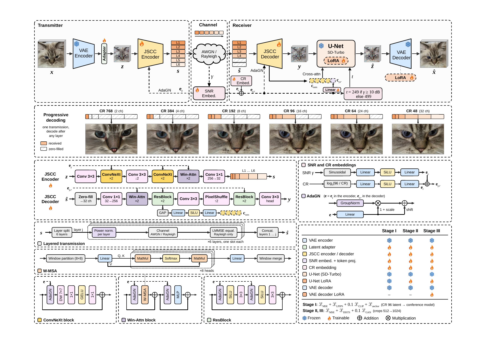
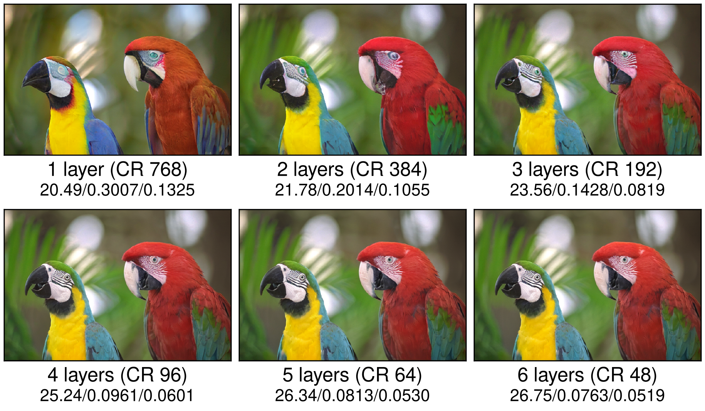

# OSD-JSCC-P

OSD-JSCC-P is the progressive, multirate journal extension of
[OSD-JSCC](../README.md). A single model encodes an image into six nested
layers. The receiver can reconstruct the image after any prefix, supporting
compression ratios (CRs) of **768, 384, 192, 96, 64, and 48**.

## Method



The transmitter encodes an image into six independently power-normalized
layers. The receiver zero-fills missing layers, conditions the JSCC decoder on
the SNR and received rate, and refines the decoded latent with one SD-Turbo
U-Net step before VAE decoding. The diagram also illustrates Rayleigh channels;
the released checkpoint and inference example below use **AWGN**.

## Progressive reconstruction



Kodak `kodim23`, transmitted once over AWGN at 3 dB. Each image is decoded
from the first one to six layers of the same transmission. Numbers below each
image are **PSNR (dB) / LPIPS / DISTS**, measured on the full image.

## Inference

Run the following commands from the repository root. The checkpoint is tracked
with Git LFS; SD-Turbo is loaded from `checkpoints/sd-turbo` if present, or
otherwise from the Hugging Face cache or Hub.

```bash
git lfs install
git lfs pull
uv sync

# Reconstruct all six rates at 10 dB.
uv run python -m osd_jscc_p.inference --input photo.png --snr-db 10

# Reconstruct selected rates for all images in a folder at two SNRs.
uv run python -m osd_jscc_p.inference \
  --input datasets/Kodak --snr-db 0 10 --rates 192 96 48
```

Reconstructions are saved under `outputs/osd_jscc_p/snr_<SNR>dB/cr_<CR>/`,
with per-image metrics in `outputs/osd_jscc_p/metrics.csv`. Use `--metrics psnr
lpips dists` to compute perceptual metrics, and `--help` for the full set of
options. The AWGN checkpoint was trained over 0–20 dB and contains the trained
parameters; it is loaded on top of
[SD-Turbo](https://huggingface.co/stabilityai/sd-turbo), which is subject to
the Stability AI Community License.

The conference model remains available through the existing root-level
`inference.py` entry point and its original checkpoint.
